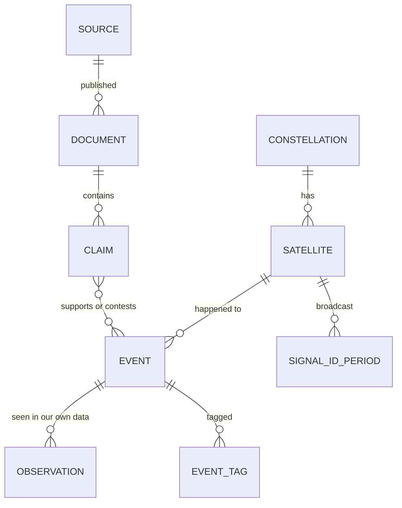

# The evidence model, on one page

How the pipeline records what is known about a satellite, who said it, and how sure we are.
The exact tables are in [`evidence/store_schema.sql`](../evidence/store_schema.sql).

## The chain

Every fact on the dashboard should be traceable along one chain:

| Record | What it is | Example |
|---|---|---|
| **Source** | Who published it. Carries a reliability grade, A to F. | The International GNSS Service (IGS) |
| **Document** | One dated copy of a page or file from a source. | The IGS satellite file as fetched on 9 Oct 2026 |
| **Claim** | One statement taken from one document. Carries a credibility grade, 1 to 6. | "Satellite C217 broadcasts signal ID C04 from 21 Apr 2026" |
| **Event** | Something that happened to a satellite. | "BeiDou-3 G1 changed signal ID from C62 to C04 on 21 Apr 2026" |

## Four rules that make it trustworthy

1. **Sources may disagree, and both stay on record.** A claim either *supports* an event or
   *contests* it. Nothing is overwritten when a second source says something different.
2. **What we measure is kept apart from what people say.** An *observation* comes from our
   own orbit or signal data. Nobody said it, so it has no source and no credibility grade.
   An event can stand on observation alone: "the operator said nothing, but we saw a burn."
3. **A satellite is identified by its physical-satellite number**, never by its name or its
   signal ID. A signal ID can pass from one satellite to another.
4. **"Last updated" is worked out, not typed in.** It is the date of the newest document
   behind any claim about that satellite.

## Where things are kept

| What | Where | Why |
|---|---|---|
| The original pages and files | A private archive, each copy named by its hash and never overwritten | A later edit or deletion at the source is itself on record |
| Which satellite is which | Plain-text tables in the repository, changed only through review | A person sees and approves every change |
| What the apps query | A small database rebuilt from the two above on every run | It can never drift from what it was built from |

The database holds a *reference* to each document (its hash, source, date and size), never
the document itself. A page that lists a satellite's history reads only small rows; the
original is fetched once, when someone opens that one document.

## What is not here yet

- **Credibility grades.** Sources are graded by a person in `evidence/source_grades.csv`.
  The credibility of single statements is empty until statements are being extracted.
- **Claims and events from real documents.** The tables are ready; nothing fills them yet.
- **A database server.** The store is a single file today. The same table definitions are
  written to serve a server database later, when a backend exists to use one.
