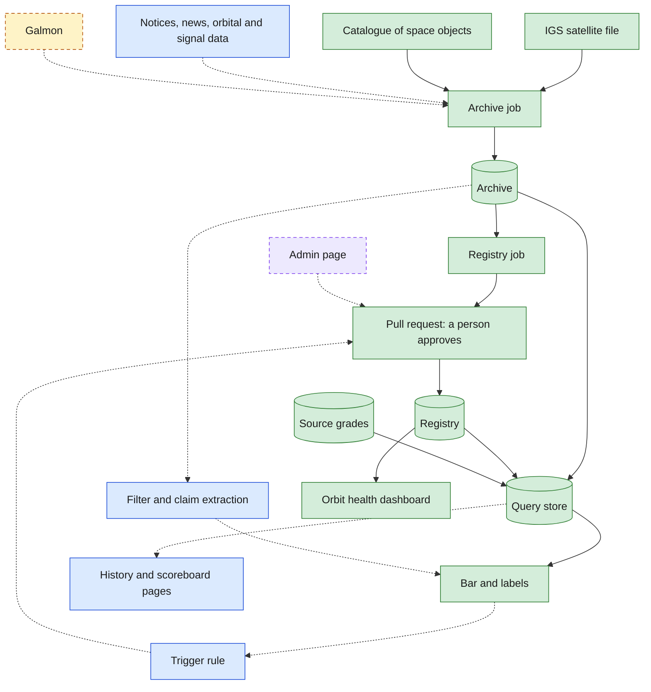
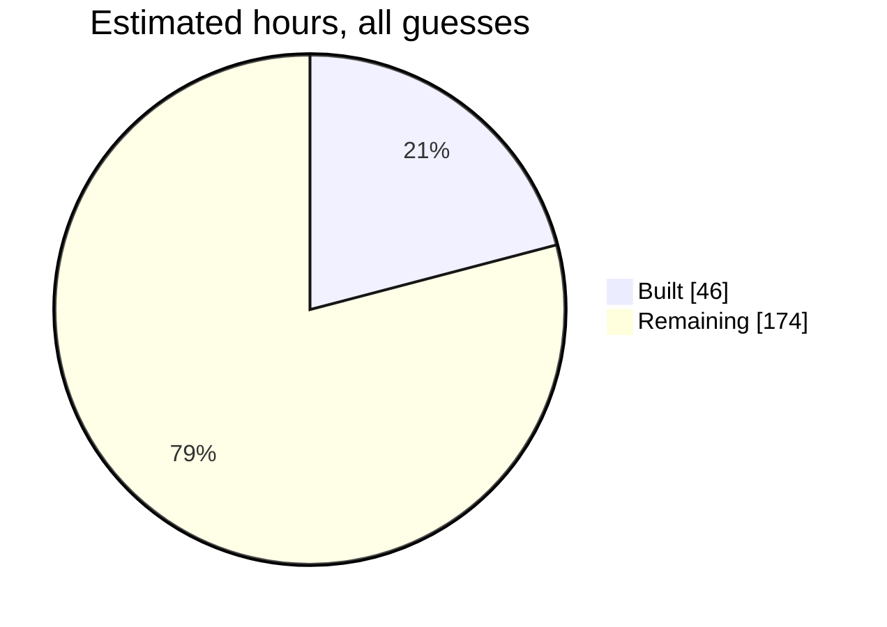
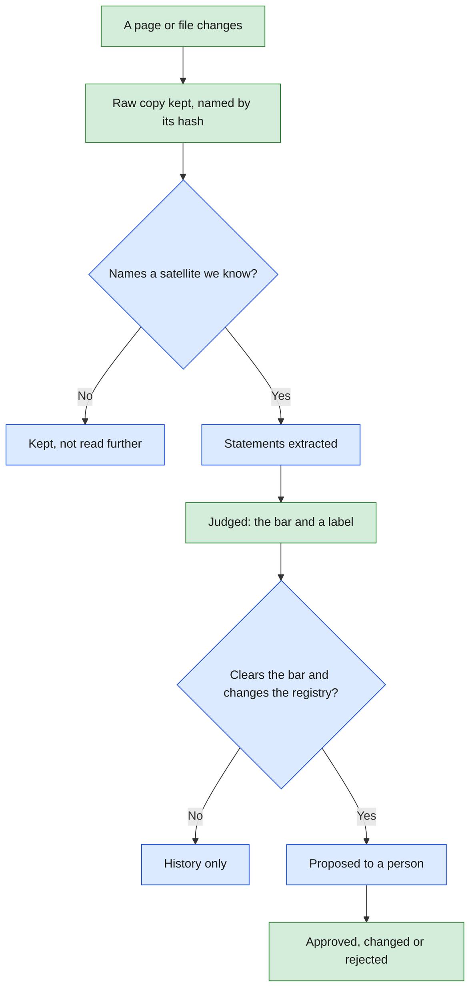
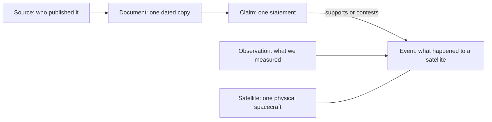

# GNSS evidence pipeline: system design

**As of 9 Oct 2026.** The one page that says what the plan is, what is built, what remains,
and what is assumed. A pull request that changes any of this changes this page too.

GNSS is Global Navigation Satellite System. IGS is the International GNSS Service.
A *pull request* is a proposed change that a person reviews and approves.

> **Standing of this page.** Everything here was decided by Sumanth Varma alone, in a private
> working copy. The team has agreed to none of it yet. Items marked "to confirm with the team"
> are open.

## 1. What it is for

Orbit data shows where a satellite is. It does not show what its operator has said, what the
press reports, or whether those match what we observe. This pipeline collects that evidence,
keeps a dated record of it, judges how far to trust it, and proposes changes for a person to
approve. It never changes reference data by itself.

## 2. What exists today

| Colour | Meaning |
|---|---|
| Green | Built and running |
| Blue | Decided, not built |
| Violet, dashed | Later |
| Amber, dashed | On hold: not to be read until Adithya has been consulted and its maintainer emailed |

Solid arrows carry data today. Dotted arrows are not wired yet.

| Box | What it does |
|---|---|
| Archive job | Fetches each source, and keeps a raw copy only when it has changed |
| Registry job | Rebuilds the table of satellites from the archived copy, and proposes any change to a person |
| Archive | A private repository of raw copies, each named by its hash and never overwritten |
| Registry | Plain-text tables saying which satellite is which, and what a second source (the catalogue) says about its owner and status |
| Query store | A small database rebuilt from the archive and the registry on every run |
| Bar and labels | Decides whether an item is confirmed, probable or unconfirmed (section 6) |
| Orbit health dashboard | The team's existing app. It reads which satellites to track, and their catalogue numbers, from the registry. Which are in service is still typed by hand (issue 14). |

## 3. How far along

| Issue | What | Hours (guess) | State |
|---|---|---|---|
| 1 | Repository setup, test job | 2 | Built |
| 3 | Identity check against the IGS file | 1 | Built |
| 4 | Registry tables, weekly change proposal | 7 | Built |
| 5 | Archive: fetch, hash, keep what changed | 10 | Built |
| 30 | A schedule per group of sources | 3 | Built |
| 11 | Evidence model and query store | 4 | Built |
| 12 | Source table, the bar, the labels | 6 | Built |
| 35 | This page | 2 | Built |
| 18 | Dashboard reads identity from the registry | 8 | Built |
| 10 | Notices ledger: GPS advisories | 10 | Next candidate |
| 13 | News, official pages, linked social posts | 14 | Waiting on a list of sources |
| 14 | Owner and status per satellite, from a second source | 3 | Built; joining the weekly proposal is a follow-up |
| 15 | Claim extraction | 20 | Waiting on a model and a spending ceiling |
| 16 | Change proposals from claims | 12 | Open |
| 6 | Internet Archive capture | 3 | Later |
| 31 | Orbital data into the archive | 6 | Later |
| 7 | Galmon snapshots | 8 | On hold |
| 8, 9 | Phone database trend; NavIC signal status | 18 | Open |
| 19, 20 | Service column; announced versus observed | 25 | Open |
| 21, 22 | Per-satellite history; scoreboard | 40 | Open |
| 17 | Admin page | 15 | Later |
| 23 | Team call, Sat 17 Oct 2026 | 3 | Open |

## 4. How one item travels

The weekly registry rebuild already runs this whole loop for one source: the IGS file is
archived, the tables are rebuilt from the archived copy, and any difference is proposed to a
person in plain words, naming the exact copy it came from.

## 5. The evidence model

Full description: [evidence-model.md](evidence-model.md). Table definitions:
[`evidence/store_schema.sql`](../evidence/store_schema.sql).

## 6. How sure we are

There is no score. Each item gets one of three labels.

"Confirmed" and "probable" reach the dashboard. "Unconfirmed" is kept and shown apart.

| Grade | Who | Graded so far |
|---|---|---|
| A | The operator: advisories and official documents | none |
| B | Intergovernmental and scientific bodies | International GNSS Service |
| C | Specialist press and expert catalogues | General Catalog of Artificial Space Objects (proposed) |
| D | General news | none |
| E, F | Social media; unattributed posts | none |

| What we have | Label |
|---|---|
| Operator notice alone | probable |
| Operator notice, and the satellite then behaves as announced | confirmed |
| IGS file alone | unconfirmed |
| IGS file and a newspaper | confirmed |
| IGS file and an anonymous post | unconfirmed |
| A newspaper, and our own data agrees | unconfirmed |
| Something we measured that nobody announced | unconfirmed |

The last two rows are known consequences of the bar as it stands, to raise with the team.

## 7. Constants

Produced from the code. A test fails if this table and the code disagree.

<!-- constants: produced by scripts/update_design_doc.py, do not edit by hand -->
| Constant | Value today | Set in |
|---|---|---|
| Documents are fetched | `30 0 * * *` (documents: once a day, 00:30 UTC = 06:00 India time) | `.github/workflows/archive.yml` |
| Catalogues are fetched | `45 0 * * *` (catalogues: once a day, 00:45 UTC = 06:15 India time, after the catalogue's own daily rebuild) | `.github/workflows/archive.yml` |
| The registry is rebuilt | `0 1 * * 0` (Sundays 01:00 UTC = 06:30 India time: half an hour after that day's documents fetch (see archive.yml), so the registry builds from a fresh copy) | `.github/workflows/registry-update.yml` |
| Sources archived, by group | documents: 1, catalogues: 2, orbital: 0, news: 0 | `evidence/sources.py` |
| Grades that clear the bar alone | A | `evidence/settings.py` |
| Grades lifted by a second source | B | `evidence/settings.py` |
| Grades lifted by our own data | B | `evidence/settings.py` |
| Grades that count as a second source | A, B, C, D | `evidence/settings.py` |
| The three labels | confirmed, probable, unconfirmed | `evidence/settings.py` |
| Longest wait for an outside server | 60 seconds | `evidence/settings.py` |
| Largest copy the archive keeps | 50 MB | `evidence/settings.py` |
| Statuses that mean a page is gone | 404, 410 | `evidence/settings.py` |
| How our requests name themselves | `gnss-evidence-archive/0.1 (scheduled research fetch)` | `evidence/settings.py` |
<!-- constants: end -->

## 8. Decisions so far

| # | Decision | Choice |
|---|---|---|
| 1 | Where the work lives | A private copy of the team's repository; the team's is read-only from here |
| 2 | Where raw copies live | A second private repository; Internet Archive capture later |
| 3 | Evidence model | Source, document, claim, event; observation kept apart from claims |
| 4 | Confidence | Two grades stored, three labels shown; the bar in section 6. **To confirm with the team.** |
| 5 | Sources for version one | Official pages, press feeds, and social posts only when they contain a link |
| 6 | Claim extraction | A language model in the scheduled job; model and spending ceiling chosen after a test |
| 7 | When to propose a change | A claim clears the bar and implies a registry change |
| 8 | How a person reviews | A pull request with a plain-language summary; an admin page later |
| 9 | Scoreboard | Satellites within a constellation by default; weights set by hand later |
| 10 | Team call, 17 Oct | Show findings and two questions; say the private copy exists |
| - | Archive layout | Each copy named by its hash, never overwritten |
| - | What the archive records | Only changes. "Last checked" is the last successful run of the job. |
| - | Storage rule | The database keeps a reference to a document, never the document |
| - | Cadence | Documents daily at 6 AM India time; catalogues daily at 6:15 AM; registry on Sundays at 6:30 AM. Short cadences first, accepting the storage; lengthen them as the product matures. |
| - | Parts out of step | Anything a person approves arrives late. Every part must keep working, and say so visibly, while another part is behind. Tests are strict at the point of approval; the running system is tolerant. |

## 9. Assumptions

| Assumption | Standing |
|---|---|
| The IGS file is right about which satellite is which | Checked once against live signals for BeiDou, 8 Oct 2026. The catalogue agrees on the launch designator of 292 of 294 satellites, 9 Oct 2026; the other two are not in it yet. |
| GitHub runs scheduled jobs close to on time | One slot was missed on 9 Oct 2026. To watch. |
| GitHub keeps a job's run history for about 90 days | Read, not verified. Beyond that, "last checked" rests on the schedule. |
| The archive's change log is only ever added to | True by construction today. Document numbers depend on it. |
| A source can be told apart by its website's host name | True for the one source so far. |
| Volumes stay small enough for a git repository | A guess: a few hundred changed pages a month. The catalogue alone adds about 24 MB a day before compression, perhaps 1.2 GB a year after (guess). GitHub advises keeping a repository under about 1 GB (source summary), so this cadence has roughly a year before it must change or the copies must move. |
| Hours in section 3 | All guesses. |

## 10. Open questions

These are for the team to settle together. The next team call is Sat 17 Oct 2026.

| Topic | Question | Holds up |
|---|---|---|
| Confidence | Is the bar in section 6 right? In particular, should our own measurement lift a news report? | - |
| Confidence | Are the source grades in section 6 right? | - |
| Confidence | Should something we measured that nobody announced get its own marking, not "unconfirmed"? | - |
| Registry | Should the catalogue's disagreements with the IGS file join the weekly proposal? | Follow-up to issue 14 |
| Confidence | Is grade C right for the catalogue of space objects? | - |
| Dashboard | Which source decides that a satellite is "inactive"? Today it is a hand-typed list; the catalogue, the IGS file and orbit data each mean something different by it. | - |
| Sources | Which publications, subreddits and pages are on the first news list? | Issue 13 |
| Sources | May we read galmon's public feed, and who emails its maintainer? | Issue 7 |
| Extraction | Which language model, and what monthly spending ceiling? | Issue 15 |
| Repository | Will the team add a licence to its repository? | - |
| Backend | Which database does the team's planned backend use? | - |

## 11. Keeping this page true

- Section 7 is produced by `python scripts/update_design_doc.py`. Run it after changing a
  schedule, a limit or the bar.
- Sections 2 and 3 are kept by hand. The pull request that closes an issue recolours its box
  and moves its row.
