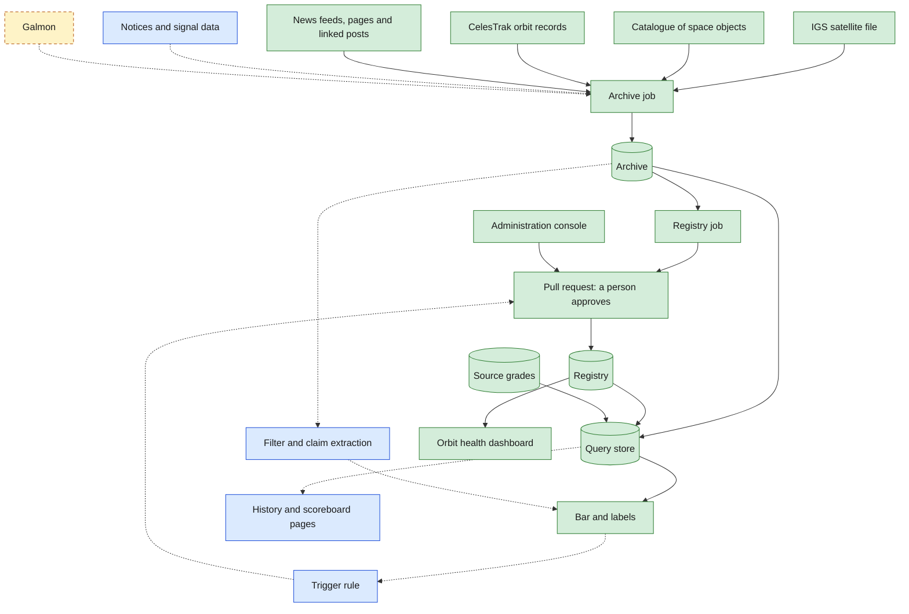
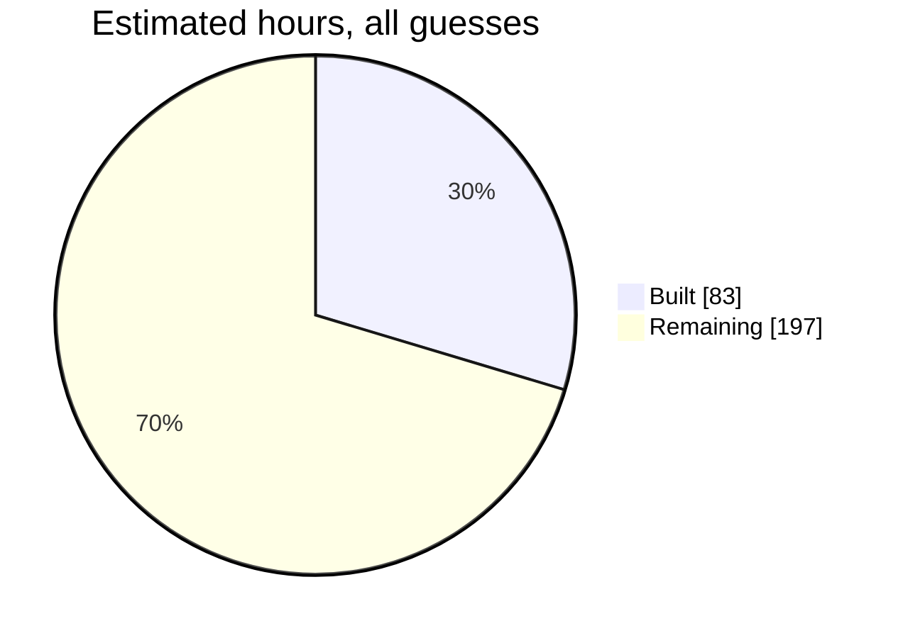
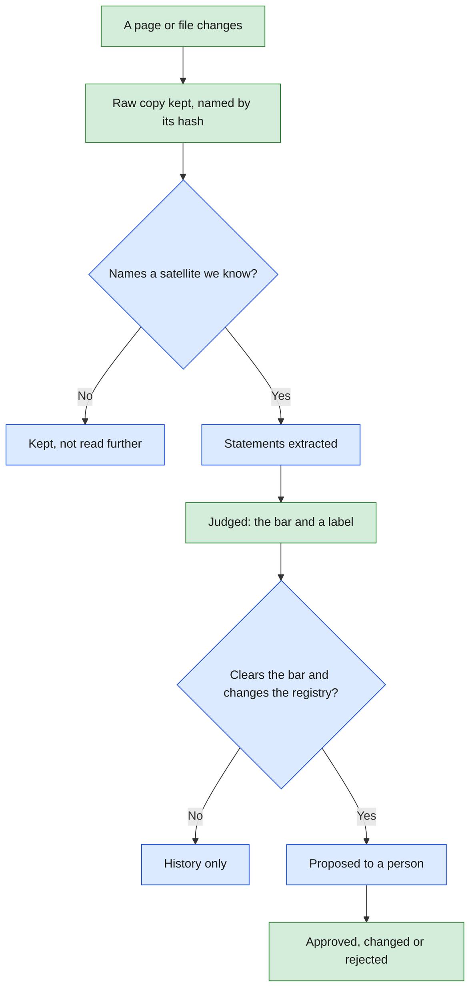
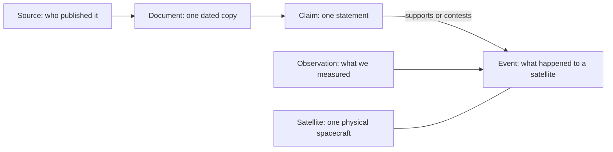
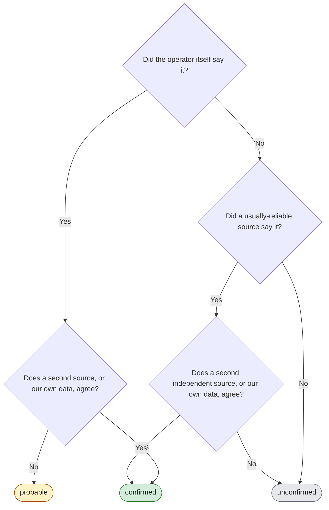

# GNSS evidence pipeline: system design

**As of 19 Oct 2026.** The one page that says what the plan is, what is built, what remains,
and what is assumed. A pull request that changes any of this changes this page too.

GNSS is Global Navigation Satellite System. IGS is the International GNSS Service.
A *pull request* is a proposed change that a person reviews and approves.

> **Standing of this page.** Everything here was decided by Sumanth Varma alone, in a private
> working copy. The team has agreed to none of it yet. Items marked "to confirm with the team"
> are open.

## 1. What it is for

Orbit data shows where a satellite is. It does not show what its operator has said, what the
press reports, or whether those match what we observe. This pipeline collects that evidence,
keeps a dated record of it, judges how far to trust it, and proposes changes for a person to
approve. It never changes reference data by itself.

## 2. What exists today

| Colour | Meaning |
|---|---|
| Green | Built and running |
| Blue | Decided, not built |
| Violet, dashed | Later |
| Amber, dashed | On hold: not to be read until Adithya has been consulted and its maintainer emailed |

Solid arrows carry data today. Dotted arrows are not wired yet.

| Box | What it does |
|---|---|
| Archive job | Fetches each source, trying a failed download again within the source's limits, and keeps a raw copy only when it has changed |
| Registry job | Rebuilds the table of satellites from the archived copy, and proposes any change to a person |
| Archive | A private repository of raw copies, each named by its hash and never overwritten, and the run log: one line per run of each scheduled job (job, start, end, result, what changed) |
| Registry | Plain-text tables saying which satellite is which, and what a second source (the catalogue) says about its owner and status. The master map page shows it: every identifier of a spacecraft resolved to one master ID, and who held each signal ID when. |
| Query store | A small database rebuilt from the archive and the registry on every run |
| Bar and labels | Decides whether an item is confirmed, probable or unconfirmed (section 6) |
| Hosting | The project's domain, `opengnss.org`, is held in its own Cloudflare account. The dashboard and the console run on Render's free plan at `dashboard.opengnss.org` and `console.opengnss.org`; Substack newsletters arrive by email and a Cloudflare Worker serves them as feeds at `feeds.opengnss.org`; scheduled jobs run on GitHub Actions. Accounts, renewal and how to recreate each part: [infrastructure.md](infrastructure.md) |
| Orbit health dashboard | Public at `dashboard.opengnss.org`. It reads which satellites to track, and their catalogue numbers, from the registry, and shows a notice for any tracked satellite it has to leave out. It draws each satellite against its own slot: flat, in 3D, and as a bar of score parts. Which are in service is still typed by hand. CelesTrak refuses the hosted server, so when a live fetch fails it reads the archive job's newest copy of CelesTrak's GNSS group (`latest_gnss.json` on the `orbit-data` branch) and says "CelesTrak via the archive job". |

## 3. How far along

| Issue | What | Hours (guess) | State |
|---|---|---|---|
| 1 | Repository setup, test job | 2 | Built |
| 3 | Identity check against the IGS file | 1 | Built |
| 4 | Registry tables, weekly change proposal | 7 | Built |
| 5 | Archive: fetch, hash, keep what changed | 10 | Built |
| 30 | A schedule per group of sources | 3 | Built |
| 11 | Evidence model and query store | 4 | Built |
| 12 | Source table, the bar, the labels | 6 | Built |
| 35 | This page | 2 | Built |
| 18 | Dashboard reads identity from the registry | 8 | Built |
| 39 | Parts out of step: keep working, and say so visibly | 6 | Parts 1 and 2 built (about 4 hours): notices for every satellite left out, set aside or partly scored. Part 3, dates and a staleness check, is open. |
| 42 | Decide where scheduled jobs run and where raw copies are kept | not sized | Decided 12 Oct 2026: stay on GitHub while its timer works. |
| 44 | Scheduled jobs in one container image, run by Kubernetes CronJob locally | 8 | Parked: not needed while GitHub's timer works |
| 79 | Production-grade running: retries, run log, alerts, late-source notices | 10 | Built: retries within each source's limits, a run log in the archive, the dashboard says since when CelesTrak has been failing, and Healthchecks.io emails when a scheduled run fails or does not arrive (the alert email was confirmed to reach a person in the failure drills, 26 Oct 2026, issue 130). |
| 45 | Archive writes through one interface: a folder today, an object store later | 5 | Parked until the archive's size starts to matter |
| 47 | Demo for the team call, Sat 17 Oct 2026 | tracker | Items 48 to 51, and 23 |
| 48 | Demo A. The look: one theme and reusable parts | 6 | Built |
| 49 | Demo B. Master map page: many identifiers to one master ID | 8 | Built |
| 50 | Demo C. Orbit pictures: slot belt, 3D view, score parts | 9 | Built |
| 51 | Demo D. Menu, How it works page, new look on the existing tabs | 6 | Open; needs 48, 49 and 50 |
| 10 | Notices ledger: GPS advisories | 10 | Open. The GPS notices (NANU) are archived through CelesTrak's copy (pull request 172); the ledger itself is not built |
| 13 | News, official pages, linked social posts | 14 | Candidates in `evidence/source_candidates.csv`, waiting on the team's grades. The 45 whose check worked are archived on a schedule, provisional, deciding nothing; feed items are read into news records (`evidence/news.py`) |
| 14 | Owner and status per satellite, from a second source | 3 | Built; joining the weekly proposal is a follow-up |
| 15 | Claim extraction | 20 | Waiting on a model and a spending ceiling |
| 16 | Change proposals from claims | 12 | Open |
| 6 | Internet Archive capture | 3 | Later |
| 31 | Orbital data into the archive | 6 | Built: CelesTrak's GNSS group, once a day |
| 7 | Galmon snapshots | 8 | On hold |
| 8, 9 | Phone database trend; NavIC signal status | 18 | Open |
| 19, 20 | Service column; announced versus observed | 25 | Open |
| 21, 22 | Per-satellite history; scoreboard | 40 | Open |
| 17 | Administration console | 15 | Built in steps (pull requests 102 to 173): Google sign-in, Summary, Jobs, Approvals (decided finding by finding), Alerts, Sources, open work, and System design with a local-model assistant. Shared copy at <https://console.opengnss.org> |
| 23 | Team call, Sat 17 Oct 2026: run-through, handout, fallback pictures | 5 | Open |
| Milestones 1–6 | Demo outcomes for the team call on Thu 29 Oct 2026 (O1–O6) | not sized | O1 orbits stay fresh (pull requests 133, 134, 140–142; the dashboard falls back to the archive job's CelesTrak copy when CelesTrak refuses it, 174), O2 news per constellation (144), O3 new satellites reach approval (135, 143, 145) and O6 approvals as findings (136, 148) are built. O4 alerts is built (131, 132, 138, 139), with 4 of 6 failure drills done (issue 130). O5, the demo pack: readiness check and script, 28 Oct |

## 4. How one item travels

The weekly registry rebuild already runs this whole loop for one source: the IGS file is
archived, the tables are rebuilt from the archived copy, and any difference is proposed to a
person in plain words, naming the exact copy it came from.

## 5. The evidence model

Full description: [evidence-model.md](evidence-model.md). Table definitions:
[`evidence/store_schema.sql`](../evidence/store_schema.sql).

## 6. How sure we are

There is no score. Each item gets one of three labels.

"Confirmed" and "probable" reach the dashboard. "Unconfirmed" is kept and shown apart.

| Grade | Who | Graded so far |
|---|---|---|
| A | The operator: advisories and official documents | none |
| B | Intergovernmental and scientific bodies | International GNSS Service |
| C | Specialist press and expert catalogues | General Catalog of Artificial Space Objects (proposed) |
| D | General news | none |
| E, F | Social media; unattributed posts | none |

| What we have | Label |
|---|---|
| Operator notice alone | probable |
| Operator notice, and the satellite then behaves as announced | confirmed |
| IGS file alone | unconfirmed |
| IGS file and a newspaper | confirmed |
| IGS file and an anonymous post | unconfirmed |
| A newspaper, and our own data agrees | unconfirmed |
| Something we measured that nobody announced | unconfirmed |

The last two rows are known consequences of the bar as it stands, to raise with the team.

## 7. Constants

Produced from the code. A test fails if this table and the code disagree.

<!-- constants: produced by scripts/update_design_doc.py, do not edit by hand -->
| Constant | Value today | Set in |
|---|---|---|
| Documents are fetched | `30 0 * * *` (documents: once a day, 00:30 UTC = 06:00 India time) | `.github/workflows/archive.yml` |
| Catalogues are fetched | `45 0 * * *` (catalogues: once a day, 00:45 UTC = 06:15 India time, after the catalogue's own daily rebuild) | `.github/workflows/archive.yml` |
| Orbit records are fetched | `15 1 * * *` (orbital: once a day, 01:15 UTC = 06:45 India time; CelesTrak allows one download per 2 hours) | `.github/workflows/archive.yml` |
| News feeds and pages are fetched | `50 */3 * * *` (news: every 3 hours from 00:50 UTC = 06:20 India time; first, to measure how often feeds change (issue 13)) | `.github/workflows/archive.yml` |
| Social media feeds are fetched | `40 1 * * *` (social: once a day, 01:40 UTC = 07:10 India time; Reddit refuses requests in quick succession) | `.github/workflows/archive.yml` |
| The registry is rebuilt | `0 1 * * 0` (Sundays 01:00 UTC = 06:30 India time: half an hour after that day's documents fetch (see archive.yml), so the registry builds from a fresh copy) | `.github/workflows/registry-update.yml` |
| Sources archived, by group | documents: 1, catalogues: 2, orbital: 1, news: 45, social: 6, x: 16 | `evidence/sources.py` |
| Grades that clear the bar alone | A | `evidence/settings.py` |
| Grades lifted by a second source | B | `evidence/settings.py` |
| Grades lifted by our own data | B | `evidence/settings.py` |
| Grades that count as a second source | A, B, C, D | `evidence/settings.py` |
| The three labels | confirmed, probable, unconfirmed | `evidence/settings.py` |
| Longest wait for an outside server | 60 seconds | `evidence/settings.py` |
| A failed download is tried | 3 times, 60 seconds apart; once a run where that is sooner than the source's gap | `evidence/settings.py` |
| Shortest gap between two requests to one site | celestrak.org: 2 hours, space-track.org: 1 hour, reddit.com: 2 minutes, news.google.com: 10 seconds, any other site: 5 seconds | `evidence/settings.py` |
| A site that refuses us waits | 1 hour, doubling with each refusal in a row, at most 7 days; refusals are 403, 429 or no answer | `evidence/settings.py` |
| Largest copy the archive keeps | 50 MB | `evidence/settings.py` |
| Statuses that mean a page is gone | 404, 410 | `evidence/settings.py` |
| How our requests name themselves | `gnss-evidence-archive/0.1 (scheduled research fetch)` | `evidence/settings.py` |
<!-- constants: end -->

## 8. Decisions so far

| # | Decision | Choice |
|---|---|---|
| 1 | Where the work lives | A private copy of the team's repository; the team's is read-only from here |
| 2 | Where raw copies live | A second private repository; Internet Archive capture later |
| 3 | Evidence model | Source, document, claim, event; observation kept apart from claims |
| 4 | Confidence | Two grades stored, three labels shown; the bar in section 6. **To confirm with the team.** |
| 5 | Sources for version one | Official pages, press feeds, and social posts only when they contain a link |
| 6 | Claim extraction | A language model in the scheduled job; model and spending ceiling chosen after a test |
| 7 | When to propose a change | A claim clears the bar and implies a registry change |
| 8 | How a person reviews | A pull request with a plain-language summary, decided in the administration console |
| 9 | Scoreboard | Satellites within a constellation by default; weights set by hand later |
| 10 | Team call, 17 Oct | Show findings and two questions; say the private copy exists |
| - | Archive layout | Each copy named by its hash, never overwritten |
| - | What the archive records | Only changes, plus one line per run of each scheduled job in its run log (`runs/<job file>.csv`). "Last checked" is the last run logged as ok. |
| - | When a failed source fails the job | A failed graded source fails the whole job. A failed news or social candidate is recorded in the run log but does not fail the job; the job fails only if the run breaks, nothing could be fetched at all, or a graded source fails. |
| - | Run log | A file in the archive, not a hosted logging service: the free ones found (Grafana Cloud, Axiom, Better Stack) keep logs 3 to 30 days and need an account, for about four lines a day. Decided 19 Oct 2026 at Sumanth's request. |
| - | Alerts | Healthchecks.io (open source, free hosted tier of 20 checks). Each scheduled run reports how it went, with its run log line, to one check per job: `archive-documents`, `archive-catalogues`, `archive-orbital`, `archive-news`, `archive-social`, `registry-update`, `update-tle-data` (which has no run log line, so it sends a short line of its own). It emails when a run fails, or when none arrives within 8 hours of its written time, which also catches a run GitHub never starts. GitHub's own failure email does not reach Sumanth (checked by him, 19 Oct 2026). |
| - | Limits per source | One place, `MIN_GAP_BETWEEN_DOWNLOADS` in `evidence/settings.py`, read by the archive job and the dashboard. A retry that would come sooner than a source's gap is not made. |
| - | Storage rule | The database keeps a reference to a document, never the document |
| - | Cadence | Documents daily at 6 AM India time; catalogues daily at 6:15 AM; orbit records daily at 6:45 AM; news every 3 hours, to measure how often each feed changes (issue 13); social media daily at 7:10 AM; registry on Sundays at 6:30 AM. Short cadences first, accepting the storage; lengthen them as the product matures. |
| - | Changes on the dashboard | Always shown visually, with colour. If there is too much to show, add filters. A satellite is added or removed only with approval and a traceable record. |
| - | GitHub-only is temporary | Scheduled jobs and raw copies will move off GitHub (issue 42). Code, registry tables and approvals stay on GitHub. |
| - | Scheduler | Stay on GitHub while its timer works; do not add complexity. If it stops working, the agreed next step is Kubernetes CronJob, then Argo Workflows when a job first needs steps that wait on each other or on a person. |
| - | The dashboard's look | Neumorphic, after CRED's Synth: dark, one accent, pictures before text. Every colour is named once in `ui/palette.py`; pages compose reusable parts and carry no styling of their own. A status is always said in words as well as colour. |
| - | A satellite and its slot | Each satellite is judged against its own slot, never the nearest one, so one that drifts onto another's slot still shows as drifted. |
| - | How the work is run | One lead session talks to Sumanth, tracks progress, briefs helper sessions, reviews their work and is the only one that pushes. Sumanth approves every pull request. |
| - | Where the console runs | Render's free plan at `console.opengnss.org`, from `main` through `render.yaml`, behind the console's own Google sign-in and list, beside the dashboard so both live on one host under the project's domain. Its settings and token live in Render as a secret file, never in the repository. First on Streamlit Community Cloud (decided 21 Oct 2026, issue 17); moved 28 Oct 2026 at Sumanth's request. |
| - | Where the dashboard runs | Render's free plan at `dashboard.opengnss.org`, from `main` through `render.yaml`, because Streamlit Community Cloud cannot use the project's own domain. It sleeps after 15 minutes unvisited and takes about a minute to wake. Decided 27 Oct 2026 at Sumanth's request. |
| - | The project's domain | `opengnss.org`, registered 27 Oct 2026 for one year in a Cloudflare account of the project's own, not anyone's personal one, so it can be handed on. Substack is read by email through it because Substack refuses GitHub's servers. Decided 27 Oct 2026 at Sumanth's request (issue 152). |
| - | Who decides an item | One approval, from anyone on the console's list, including the person who raised it (decided 22 Oct 2026; the earlier rule that the raiser could not decide is gone). Two or more approvals, with an optional standing second approver such as a senior, are planned (issue 120). |
| - | The assistant on the shared console | It asks the Ollama on Sumanth's Mac through Tailscale Funnel (free, a fixed https address). Funnel exposes only a gate, `scripts/ollama_gate.py`: it passes questions for the one model and the version check, needs a key, and takes one question at a time. Ollama itself is never exposed. Questions work only while the Mac is awake with Ollama, the gate and the tunnel running; otherwise the page says they are off. Decided 22 Oct 2026 at Sumanth's request. |
| - | Parts out of step | Anything a person approves arrives late. Every part must keep working, and say so visibly, while another part is behind. Tests are strict at the point of approval; the running system is tolerant. |

## 9. Assumptions

| Assumption | Standing |
|---|---|
| The IGS file is right about which satellite is which | Checked once against live signals for BeiDou, 8 Oct 2026. The catalogue agrees on the launch designator of 292 of 294 satellites, 9 Oct 2026; the other two are not in it yet. |
| GitHub runs scheduled jobs close to on time | **Late, not broken.** All 6 scheduled runs from 10 to 12 Oct 2026 started and succeeded, each about 5¾ hours late: a job due at 6:00 AM India time runs near 11:50 AM (checked). A daily fetch tolerates that; nothing may depend on two jobs running in a set order. |
| GitHub keeps a job's run history for about 90 days | Read, not verified. The run log in the archive keeps every run since 19 Oct 2026. |
| GitHub emails a failed scheduled run to the person who last changed its schedule line | Source summary (community answers, not GitHub's documentation). It does not reach Sumanth (checked by him, 19 Oct 2026), so alerts go through Healthchecks.io. |
| A run starts within 8 hours of its written time | Runs were 4 to 6½ hours late from 10 to 16 Oct 2026 (checked). Healthchecks.io's grace time is set to 8 hours on that basis; a run later than that is reported as missing. |
| The archive's change log is only ever added to | True by construction today. Document numbers depend on it. |
| A source can be told apart by its website's host name | True for the three sources so far. |
| Volumes stay small enough for a git repository | A guess: a few hundred changed pages a month. The catalogue adds about 24 MB before compression each time it changes. It changed on 2 of the first 3 days (checked), so perhaps 0.8 GB a year after compression (guess). GitHub advises keeping a repository under about 1 GB (source summary), so this cadence has roughly a year before it must change or the copies must move. |
| Hours in section 3 | All guesses. |

## 10. Open questions

These are for the team to settle together. The next team call is Thu 29 Oct 2026.

| Topic | Question | Holds up |
|---|---|---|
| Confidence | Is the bar in section 6 right? In particular, should our own measurement lift a news report? | - |
| Confidence | Are the source grades in section 6 right? | - |
| Confidence | Should something we measured that nobody announced get its own marking, not "unconfirmed"? | - |
| Registry | Should the catalogue's disagreements with the IGS file join the weekly proposal? | Follow-up to issue 14 |
| Confidence | Is grade C right for the catalogue of space objects? | - |
| Dashboard | Should the size of a constellation be the number of satellites tracked, or the number with data? Today it is the number tracked, so tracking three more NavIC satellites moves IRNSS-1G from healthy to fair. | - |
| Dashboard | Which source decides that a satellite is "inactive"? Today it is a hand-typed list; the catalogue, the IGS file and orbit data each mean something different by it. | - |
| Sources | Which publications, subreddits and pages are on the first news list? | Issue 13 |
| Sources | May we read galmon's public feed, and who emails its maintainer? | Issue 7 |
| Extraction | Which language model, and what monthly spending ceiling? | Issue 15 |
| Repository | Will the team add a licence to its repository? | - |
| Backend | Which database does the team's planned backend use? | - |
| Orbits | Is 2 days the right freshness target? For some satellites, mostly Galileo, neither CelesTrak nor Space-Track has anything newer for 3 to 8 days. | O1's "every satellite under 2 days" |
| Orbits | May a daily copy of CelesTrak's GNSS group be kept on a public branch (`orbit-data`) for the dashboard, which CelesTrak refuses? | - |

## 11. Keeping this page true

- Section 7 is produced by `python scripts/update_design_doc.py`. Run it after changing a
  schedule, a limit or the bar.
- Sections 2 and 3 are kept by hand. The pull request that closes an issue recolours its box
  and moves its row.
